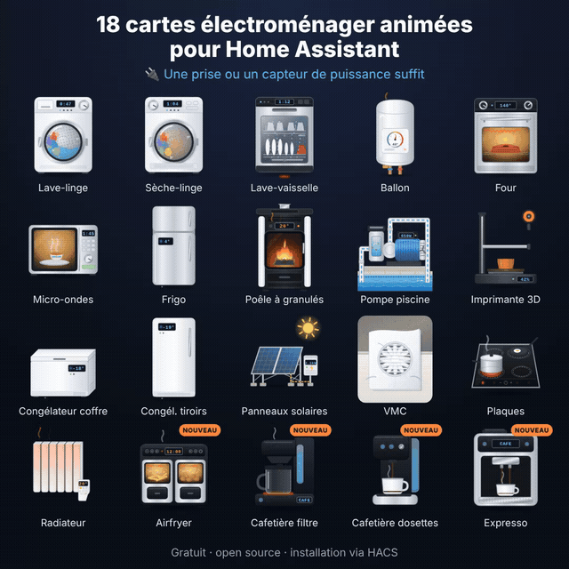

# Appliance Électroménager Cards for Home Assistant

[](https://hacs.xyz)
[](https://github.com/skyrotter/ha-appliance-electromenager-cards/actions/workflows/validate.yml)
[](LICENSE)

🇬🇧 English · [🇫🇷 Version française](README.fr.md)

<p align="center"></p>

**44 Lovelace cards for household appliances**, each with a realistic animated illustration: a tumbling washer drum, a flickering pellet-stove flame, a diesel heater with its blue burner crown, a hot tub with bubbling jets, a robot vacuum, a Linky meter, a home battery… They show the live status, power, energy and cost, follow your Home Assistant theme (light/dark) and speak English, French, German, Norwegian, Dutch and Romanian.

A simple smart plug with a power sensor is enough. Connected appliances can add program, remaining time, progress, door, temperatures…

**▶ [Try it online](https://skyrotter.github.io/ha-appliance-electromenager-cards/docs/demo.html)** (simulated data, no Home Assistant needed) · [Watch the video](docs/electromenager-43-cartes-facebook.mp4) · [Automated tests](https://skyrotter.github.io/ha-appliance-electromenager-cards/docs/tests.html)

## Installation

**HACS (recommended)**

1. Open HACS → **Dashboard** (Frontend) and search for **Appliance Cards**.
2. Click **Download**, then reload your browser (Ctrl+F5).

If the search does not find it yet: HACS → ⋮ → *Custom repositories* → add `https://github.com/skyrotter/ha-appliance-electromenager-cards` with the category **Dashboard**.

**Manual**

1. Copy `dist/ha-appliance-electromenager-cards.js` to `/config/www/`.
2. Settings → Dashboards → ⋮ → Resources → add `/local/ha-appliance-electromenager-cards.js` (JavaScript module).

## Quick start

Every card has a visual editor. When you add one from the card picker, entities are detected by name (`lave_linge`, `washer`, `fridge`, `ballon`…). In YAML:

```yaml
type: custom:appliance-washer-card
entity: input_boolean.washer_running   # optional status entity
power: sensor.washer_plug_power        # a smart plug is enough
energy: sensor.washer_plug_energy_today
cost: sensor.washer_cost_today
```

All options, how the status is computed, theming and the power-button safety are in **[docs/configuration.md](docs/configuration.md)**.

## The cards

Click a card for its options and examples.

### Kitchen and laundry

| Card | Type |
|---|---|
| [Washing machine](docs/cards/washer-dryer-dishwasher.md) | `custom:appliance-washer-card` |
| [Dryer](docs/cards/washer-dryer-dishwasher.md) | `custom:appliance-dryer-card` |
| [Dishwasher](docs/cards/washer-dryer-dishwasher.md) | `custom:appliance-dishwasher-card` |
| [Oven](docs/configuration.md#type-specific-options) | `custom:appliance-oven-card` |
| [Microwave](docs/configuration.md#type-specific-options) | `custom:appliance-microwave-card` |
| [Refrigerator (4 layouts)](docs/cards/wine-cooler-fridge.md) | `custom:appliance-fridge-card` |
| [Chest freezer](docs/cards/freezers.md) | `custom:appliance-chest-freezer-card` |
| [Upright drawer freezer](docs/cards/freezers.md) | `custom:appliance-drawer-freezer-card` |
| [Electric cooktop](docs/cards/hob.md) | `custom:appliance-hob-card` |
| [Air fryer (dual basket)](docs/cards/air-fryer.md) | `custom:appliance-air-fryer-card` |
| [Coffee maker (drip, pods, espresso)](docs/cards/coffee-maker.md) | `custom:appliance-coffee-maker-card` |
| [Range hood](docs/cards/tv-range-hood.md) | `custom:appliance-range-hood-card` |
| [Wine cooler (single or dual zone)](docs/cards/wine-cooler-fridge.md) | `custom:appliance-wine-cooler-card` |
| [Beer tap](docs/cards/beer-tap-av-receiver.md) | `custom:appliance-beer-tap-card` |

### Heating, hot water and air

| Card | Type |
|---|---|
| [Water heater (with solar router)](docs/cards/water-heater.md) | `custom:appliance-water-heater-card` |
| [Electric radiator](docs/cards/radiator.md) | `custom:appliance-radiator-card` |
| [Heated towel rail](docs/cards/towel-rack-pc-laptop.md) | `custom:appliance-towel-dryer-card` |
| [Pellet stove](docs/cards/pellet-stove.md) | `custom:appliance-pellet-stove-card` |
| [Pellet boiler](docs/cards/pellet-boiler.md) | `custom:appliance-pellet-boiler-card` |
| [Gas boiler](docs/cards/gas-boiler.md) | `custom:appliance-gas-boiler-card` |
| [Diesel heater](docs/cards/diesel-heater.md) | `custom:appliance-diesel-heater-card` |
| [Water-to-water / ground source heat pump](docs/cards/water-heat-pump.md) | `custom:appliance-water-heat-pump-card` |
| [Air conditioner, indoor split](docs/cards/air-conditioning.md) | `custom:appliance-ac-split-card` |
| [Heat pump, outdoor unit](docs/cards/air-conditioning.md) | `custom:appliance-heat-pump-card` |
| [Bathroom extractor fan (VMC)](docs/cards/vmc.md) | `custom:appliance-vmc-card` |

### Energy, pool, spa and aquarium

| Card | Type |
|---|---|
| [Solar panels](docs/cards/solar.md) | `custom:appliance-solar-card` |
| [Home battery](docs/cards/battery.md) | `custom:appliance-battery-card` |
| [EV charger (wallbox + car)](docs/cards/ev-charger.md) | `custom:appliance-ev-charger-card` |
| [Linky electricity meter](docs/cards/linky.md) | `custom:appliance-linky-card` |
| [Pool pump](docs/cards/pool-pump.md) | `custom:appliance-pool-pump-card` |
| [Hot tub (jacuzzi)](docs/cards/jacuzzi.md) | `custom:appliance-jacuzzi-card` |
| [Aquarium](docs/cards/aquarium.md) | `custom:appliance-aquarium-card` |

### Entertainment and IT

| Card | Type |
|---|---|
| [Flat TV](docs/cards/tv-range-hood.md) | `custom:appliance-tv-card` |
| [Home cinema amplifier (AV receiver)](docs/cards/beer-tap-av-receiver.md) | `custom:appliance-av-receiver-card` |
| [Server rack (homelab)](docs/cards/towel-rack-pc-laptop.md) | `custom:appliance-server-rack-card` |
| [Desktop PC](docs/cards/towel-rack-pc-laptop.md) | `custom:appliance-desktop-pc-card` |
| [Laptop](docs/cards/towel-rack-pc-laptop.md) | `custom:appliance-laptop-card` |
| [3D printer](docs/cards/printer-3d.md) | `custom:appliance-printer-3d-card` |

### Robots, fans and more

| Card | Type |
|---|---|
| [Robot vacuum](docs/cards/robots.md) | `custom:appliance-robot-vacuum-solo-card` |
| [Robot mower](docs/cards/robots.md) | `custom:appliance-robot-mower-solo-card` |
| [Fan](docs/cards/fan.md) | `custom:appliance-fan-card` |
| [Ceiling fan](docs/cards/ceiling-fan.md) | `custom:appliance-ceiling-fan-card` |
| [Tool battery charger](docs/cards/tool-charger.md) | `custom:appliance-tool-charger-card` |
| [Generic appliance (your own image)](docs/cards/generic.md) | `custom:appliance-generic-card` |

## Documentation

- [Configuration](docs/configuration.md): common options, how the status is computed, modes, theming, power-button safety.
- [Cycle detection for washers, dryers and dishwashers](docs/cards/washer-dryer-dishwasher.md): the recommended automation with a smart plug.
- [Development and translations](docs/development.md): build, adding a card or a language.
- [Descriptions en français](docs/cards-fr.md)

## Contributing

Bug reports and card requests are welcome in the [issues](https://github.com/skyrotter/ha-appliance-electromenager-cards/issues). `dist/` is generated: edit `src/`, run `node build.js`, and commit both (see [development](docs/development.md)).

## License

[MIT](LICENSE)
