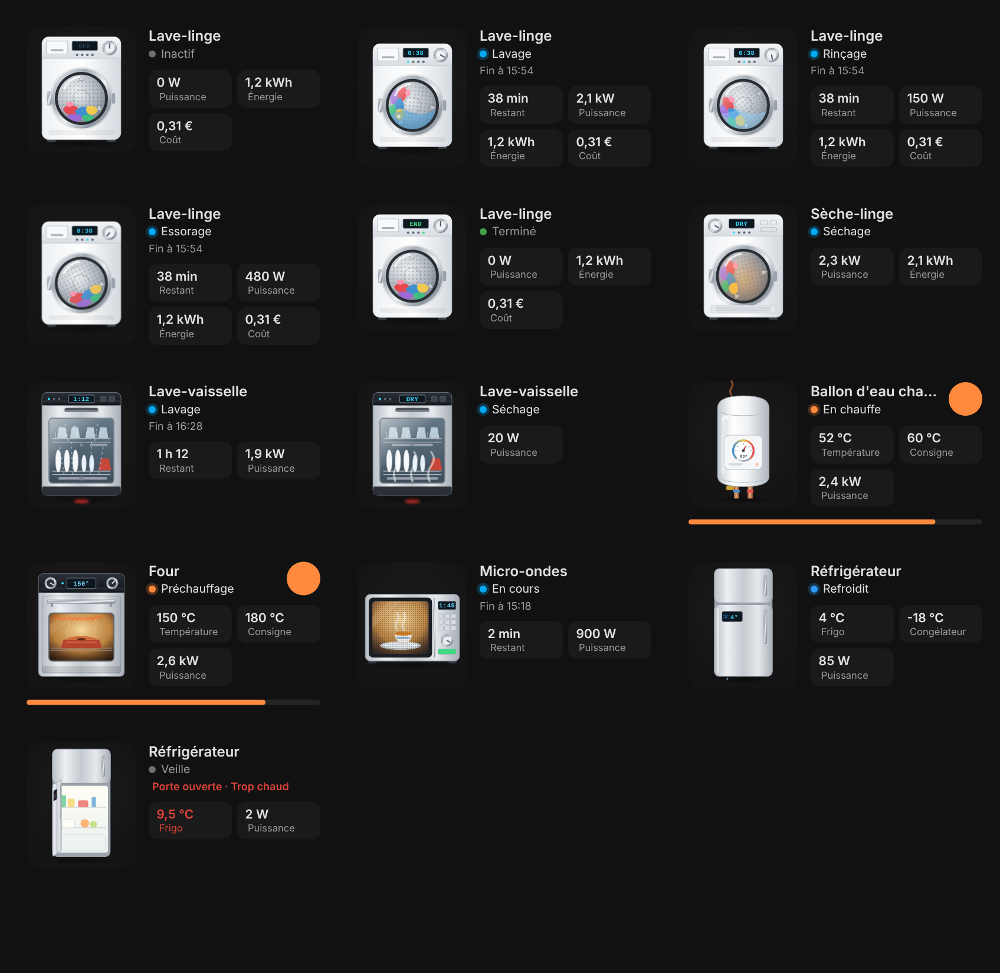

# Appliance Cards for Home Assistant

[](https://hacs.xyz/docs/faq/custom_repositories)
[](https://github.com/skyrotter/ha-appliance-electromenager-cards/actions/workflows/validate.yml)

Seven Lovelace cards for household appliances, with **realistic animated illustrations** (tumbling drum, water and foam, spin with vibration, rotating spray arms, glowing oven element, turntable, opening fridge door…), live status, power, energy and cost.
They follow your Home Assistant theme (light/dark) and switch between **French** and **English** automatically.

**▶ [Try it online / Essayer en ligne](https://skyrotter.github.io/ha-appliance-electromenager-cards/docs/demo.html)** · [Automated tests](https://skyrotter.github.io/ha-appliance-electromenager-cards/docs/tests.html)

*🇫🇷 Version française plus bas.*



| Card | Type |
|---|---|
| Washing machine | `custom:appliance-washer-card` |
| Dryer | `custom:appliance-dryer-card` |
| Dishwasher | `custom:appliance-dishwasher-card` |
| Water heater | `custom:appliance-water-heater-card` |
| Oven | `custom:appliance-oven-card` |
| Microwave | `custom:appliance-microwave-card` |
| Refrigerator | `custom:appliance-fridge-card` |

Works with a simple smart plug (power sensor only) as well as with connected appliances (program, remaining time, progress, door…).

## Installation

### HACS (recommended)

1. HACS → ⋮ → **Custom repositories** → add `https://github.com/skyrotter/ha-appliance-electromenager-cards`, category **Dashboard**.
2. Search for **Appliance Cards**, install, then reload your browser (Ctrl+F5).

### Manual

1. Copy `dist/ha-appliance-electromenager-cards.js` to `/config/www/`.
2. Settings → Dashboards → ⋮ → Resources → add `/local/ha-appliance-electromenager-cards.js` (JavaScript module).

## Configuration

All cards have a visual editor. When added from the card picker, entities are detected automatically by name (`lave_linge`, `washer`, `dryer`, `frigo`, `ballon`…).

### Common options

| Option | Description |
|---|---|
| `entity` | Status entity: `switch`, `input_boolean`, `binary_sensor`, `sensor`, `input_select`, `water_heater`… |
| `power` | Power sensor (W or kW) |
| `energy` | Energy sensor (kWh) — e.g. today's consumption |
| `cost` | Cost sensor (any currency) |
| `switch` | Switch controlled by the power button (button hidden if unset) |
| `threshold` | Power above which the appliance is considered running (W). Defaults: 10 (washer/dryer/dishwasher), 20 (fridge), 50 (others) |
| `name` | Custom name |
| `color` | Accent color (any CSS color) |
| `show_toggle` | `false` to hide the power button |
| `animations` | `false` to disable animations |
| `confirm_off` | Washer, dryer, dishwasher: `false` to turn off the safety confirmation (default `true`, see below) |

### Type-specific options

| Option | Cards |
|---|---|
| `remaining` | washer, dryer, dishwasher, oven, microwave — minutes, `H:MM[:SS]`, or a timestamp of the end |
| `progress` | washer, dryer, dishwasher — % |
| `program` | washer, dryer, dishwasher, oven, microwave |
| `door` | all except water heater (`binary_sensor`, `on` = open) |
| `temperature`, `target_temperature` | water heater, oven, fridge (`temperature` only) |
| `freezer_temperature`, `freezer_door` | fridge |
| `max_temperature` (default 8), `freezer_max_temperature` (default −12) | fridge alerts |

### How the status is computed

1. `entity` set to a descriptive state (`running`, `finished`, `idle`, `off`… or a free text such as *Rinsing*) → used as-is.
2. `entity` is an `input_boolean`/`binary_sensor` → `on` = running.
3. `entity`/`switch` is a plug that is on → the **power sensor** decides (above `threshold` = running, otherwise standby).
4. Power only → above `threshold` = running.

**Phases** (washer, dryer, dishwasher): if the status entity or `program` contains *wash/lavage*, *rinse/rinçage*, *spin/essorage*, *dry/séchage* or *cool/refroidissement*, the illustration and LCD follow that phase (water, foam, fast spin…). Otherwise the default phase is used.

Tip: for washers, a cycle-detection automation driving an `input_boolean` is more reliable than raw power (soaking phases drop to a few watts). Ready-to-use example below.

### Smart plug + cycle detection (recommended for washer, dryer, dishwasher)

A washer pauses, soaks and heats in steps: its power can drop to a few watts for several minutes in the middle of a cycle. Reading raw power alone makes the card flicker between *Running* and *Standby*. This automation fixes that. It decides a cycle has **started** when power stays above 100 W for 30 s, and that it has **ended** when power stays below 20 W for 8 minutes.

**1. Create the helper:** Settings → Devices & services → Helpers → Create helper → Toggle → name it `Washer running` (entity `input_boolean.washer_running`). Or in YAML:

```yaml
input_boolean:
  washer_running:
    name: Washer running
    icon: mdi:washing-machine
```

**2. Add the automation** (Settings → Automations → ⋮ → Edit in YAML). Replace `sensor.washer_plug_power` with your plug's power sensor:

```yaml
alias: Washer – cycle detection
mode: restart
triggers:
  - trigger: numeric_state
    entity_id: sensor.washer_plug_power
    above: 100
    for: "00:00:30"
    id: start
  - trigger: numeric_state
    entity_id: sensor.washer_plug_power
    below: 20
    for: "00:08:00"
    id: end
actions:
  - choose:
      - conditions:
          - condition: trigger
            id: start
        sequence:
          - action: input_boolean.turn_on
            target:
              entity_id: input_boolean.washer_running
      - conditions:
          - condition: trigger
            id: end
          - condition: state
            entity_id: input_boolean.washer_running
            state: "on"
        sequence:
          - action: input_boolean.turn_off
            target:
              entity_id: input_boolean.washer_running
          # optional: get notified when the laundry is done
          # - action: notify.mobile_app_your_phone
          #   data:
          #     message: "The washing machine is done 🧺"
```

**3. Use it in the card:**

```yaml
type: custom:appliance-washer-card
entity: input_boolean.washer_running
power: sensor.washer_plug_power
energy: sensor.washer_plug_energy_today
```

Suggested values: washer 100 W / 20 W / 8 min, dryer 100 W / 15 W / 5 min, dishwasher 50 W / 10 W / 10 min (dishwashers sit at a few watts while drying). Adjust them to your appliance by looking at its power history. Requires Home Assistant 2024.10 or newer for the `triggers:` / `actions:` syntax; on older versions, use `trigger:` / `platform:` / `action:` / `service:`.

### Power button safety

The power button only appears when you set `switch:`. On the **washer, dryer and dishwasher**, cutting the plug **while a cycle is running** takes **two clicks**: the first one turns the button red and shows "Cycle running – click again to cut power" for 4 seconds. Turning the plug on, or off while idle, stays a single click. Set `confirm_off: false` to turn this off.

Advice: on a washing machine you usually don't need `switch:` at all. Leave it out and the button won't be shown.

### Examples

```yaml
type: custom:appliance-washer-card
entity: input_boolean.washer_running
power: sensor.washer_power
energy: sensor.washer_energy_daily
cost: sensor.washer_cost_today
```

```yaml
type: custom:appliance-water-heater-card
switch: switch.water_heater
power: sensor.water_heater_power
temperature: sensor.water_heater_temperature
target_temperature: input_number.water_heater_target
```

```yaml
type: custom:appliance-fridge-card
power: sensor.fridge_power
temperature: sensor.fridge_temperature
freezer_temperature: sensor.freezer_temperature
door: binary_sensor.fridge_door
```

### Theming

The cards use your theme variables. You can override them in a theme or with card-mod:

```yaml
appliance-active-color: "#03a9f4"
appliance-heat-color: "#ff8a3d"
appliance-cold-color: "#2b9af9"
appliance-alert-color: "#db4437"
appliance-ok-color: "#43a047"
appliance-illustration-size: 116px
```

---

## 🇫🇷 En français

Sept cartes Lovelace pour l'électroménager (lave-linge, sèche-linge, lave-vaisselle, ballon d'eau chaude, four, micro-ondes, réfrigérateur) : illustration animée, état en direct, puissance, énergie et coût. Elles suivent le thème de Home Assistant et s'affichent en français si Home Assistant est en français.

**Installation HACS** : HACS → ⋮ → *Dépôts personnalisés* → `https://github.com/skyrotter/ha-appliance-electromenager-cards`, catégorie **Dashboard** → installer → recharger le navigateur (Ctrl+F5).

**Configuration** : éditeur visuel disponible ; les entités sont détectées automatiquement à l'ajout (noms contenant `lave_linge`, `seche_linge`, `lave_vaisselle`, `ballon`, `four`, `micro_ondes`, `frigo`, `washer`, `dryer`, `fridge`…). Les options sont les mêmes que ci-dessus.

```yaml
type: custom:appliance-washer-card
entity: binary_sensor.lave_linge_en_cours
power: sensor.lave_linge_puissance
energy: sensor.lave_linge_energie_jour
cost: sensor.lave_linge_cout_jour
```

**Prise connectée + détection de cycle** : pour le lave-linge, le sèche-linge et le lave-vaisselle, utilise l'automatisation de détection de cycle décrite plus haut (section *Smart plug + cycle detection*). Elle allume un `input_boolean` au démarrage (plus de 100 W pendant 30 s) et l'éteint à la fin (moins de 20 W pendant 8 min). Ça évite que la carte passe en « Veille » pendant le trempage.

**Sécurité du bouton marche/arrêt** : sur le lave-linge, le sèche-linge et le lave-vaisselle, couper la prise pendant un cycle demande deux clics (le bouton devient rouge et affiche « Cycle en cours – cliquer encore pour couper »). Option `confirm_off: false` pour désactiver. Conseil : sur un lave-linge, ne mets pas de `switch:` du tout.

## License

MIT

## Demo

- Interactive test page (simulated data, no Home Assistant needed): https://skyrotter.github.io/ha-appliance-electromenager-cards/docs/demo.html
- Automated tests: https://skyrotter.github.io/ha-appliance-electromenager-cards/docs/tests.html
